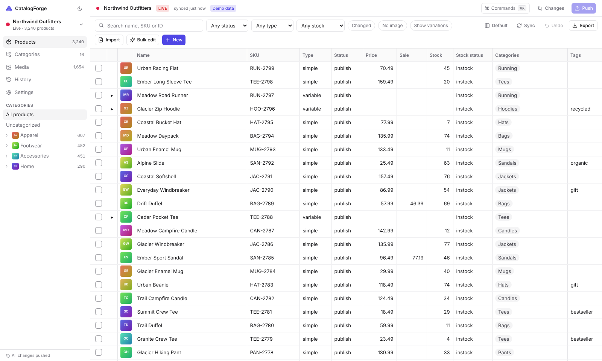

# CatalogForge

A desktop catalog manager for WooCommerce, built to get **large numbers of products, categories and images into a store as fast and safely as possible**. It works with live stores and with sites running in **Local** (formerly Local by Flywheel), and manages many stores from one window.

It replaces the workflow of tools like eMagicOne Store Manager with a modern, cross-platform app (macOS, Windows, Linux) built on Tauri + Rust + React.



## What it does

| Area | What you get |
|---|---|
| **Connections** | Four connection types behind one interface: **Local (Flywheel)** with zero setup, the **CatalogForge Connector** plugin (recommended for live stores), the stock **WooCommerce REST API** (no plugin), and **direct MySQL** for very fast reads. |
| **Spreadsheet grid** | Canvas-rendered grid that stays smooth at 100k+ rows. Edit inline, paste ranges from Excel or Google Sheets, drag-fill, multi-select, sort, saved column views (built-in Pricing, Inventory, Shipping and SEO, plus your own named views), drag-and-drop column order, list cells (status, stock status, visibility, type) that open a dropdown in the grid and can apply to every ticked row, and expandable variations (▸ in front of the name). |
| **Edit panel** | A panel under the grid (or docked on the right) that edits every ticked product at once, in WooCommerce's sections: content, general, inventory, shipping, linked products, attributes, advanced, categories, tags, gallery, custom fields, SEO and brands. Fields where products differ say **Mixed** with the range; prices and stock take quick maths (`+10%`, `-5`, `=regular_price*0.8`) with a live count of what changes. Find any field, show only the ones that differ, undo per field, resize, fold with Ctrl+E. |
| **Safe by design** | Nothing touches the store until you **Push**. Every edit is staged as a diff (green = new, yellow = changed, red = deleted). There is one-step **Undo** for any edit or bulk operation, field-level **conflict detection** if someone edits the same field in wp-admin, and a **History** of every push with one-click **Revert**. |
| **Import** | Drop a CSV/XLSX/ODS/JSON file plus an image folder. Columns are auto-mapped (including Shopify exports). You can transform values with Excel-style formulas, group rows into variable products, create missing categories from paths like `Apparel > Tees`, match images by file name or by SKU, validate before anything is staged, and save mappings per supplier. |
| **Bulk edit** | Several changes in one go (each sees the ones before it). Change prices by %, apply charm pricing (.99), set sales as % off, find and replace (with regex), change case, set categories and tags, or use any formula. A live before/after preview shows exactly which products change. |
| **WYSIWYG** | Rich-text editor for descriptions that cleans text pasted from Word or Google Docs. A **live preview renders the product in your store's real theme** with unsaved edits applied, including stores in WooCommerce "coming soon" mode. |
| **Media** | Images are resized, converted to WebP and given **every WordPress thumbnail size on your computer**, so the server does no image processing. Duplicates are detected by checksum, files are named from a template (`{sku}-{name}-{n}`), and you can drag to reorder galleries. For Local sites, files are written straight to `wp-content/uploads`. |
| **Categories** | Drag-to-nest tree, thumbnail and banner images, WYSIWYG descriptions, SEO fields, and assigning products to categories from the grid. |
| **Variations** | A matrix generator (pick sizes × colours, get every combination, existing ones detected), set-all price/stock/weight, and a command to group existing simple products as variations of one product. |
| **Multi-store** | Store switcher with colour-coded environments (Local / Staging / **LIVE**). **Clone products between stores** (for example, build on Local, then promote to live): categories are matched by path, images are re-uploaded, and existing SKUs are updated instead of duplicated. |
| **Batch Builder** | Build whole product collections from a reusable **blank** (price, stock, sizes, tags, descriptions with `{price}`-style tokens, options for variable products) × a **design collection** (numbered designs or a list of names). Drop in images and they're matched to products by the number in the file name (or file order), with featured + gallery slots you can swap by clicking, plus shared gallery images such as size charts. It checks the batch against your store (existing SKUs to skip or update, new categories, price text that doesn't match the price, broken emojis, ChatGPT markup) and suggests the next free number. **Add to store** stages everything in one step; CSV and ZIP export in the Store Manager / WP All Import layout are still there. Blanks can be made from any store product. |
| **Migration** | Move a whole catalogue into another store, typically a new, empty one: categories (hierarchy, descriptions, images, order, SEO), products, variations, attributes, tags, images and custom fields. A pre-flight check compares the two stores (counts, existing SKUs, currency and unit differences, products without SKUs) before anything is staged; the migration is staged as one undoable step and pushed with the usual confirmation; a final check compares both stores product by product. Images are downloaded by the app and uploaded fresh, so moving from a Local site to a live host works. Safe to run again: existing and already-staged products are skipped. |
| **Safe pushes** | Every push asks *"Are you sure you want to push changes?"* with a summary of what will change and a warning for LIVE stores. |
| **Custom fields** | Fields added by other plugins (ACF, brands, barcodes, supplier codes…) are discovered on your store, with ACF labels and guessed types. Pick the ones you want and they become grid columns, a tab in the product editor, bulk-edit targets and import/export columns, with the same staging, undo and conflict checks as built-in fields. |
| **Catalogue PDF** | A print-ready catalogue of your products, indexed by category: cover, contents with clickable page numbers, optional divider pages, grid / list / price-list / one-per-page layouts, an A–Z product index and a back cover. Leave out any parent category, sub-category or product. Use your own PDF template (cover, contents, left and right pages, back cover); every text element on the cover, header and footer has its own font, weight, size, colour and alignment. Bundled fonts (Inter, Montserrat, Playfair Display, Lora, Oswald) or your own TTF/OTF files. Product QR codes, clickable links, PDF bookmarks, sale badges, trade price adjustment, watermark, saved designs and a live preview as printed spreads. |
| **Your look** | Six subtle themes plus your own accent colour, light/dark/match computer, red close and cancel buttons in three styles, compact rows, corner and text size, all under Settings → Appearance. |
| **Speed** | ⌘K command palette for every action, keyboard shortcuts (⌘S push, ⌘Z undo), and CSV export of any view. |

## Repository layout

```
crates/forge-core/        Rust engine: drivers, SQLite cache + staging, sync, media pipeline
apps/desktop/             Tauri v2 desktop app (React + TypeScript UI)
  src/                    UI, formula engine, import pipeline, demo backend
  src-tauri/              Rust command layer (bundles the connector plugin)
  e2e/run.mjs             End-to-end UI test (Playwright)
plugin/catalogforge-connector/   WordPress plugin installed on the store
plugin/tests/smoke.php    Plugin end-to-end test against a real store
docs/                     Architecture, connector protocol, roadmap
```

## Running it

Prerequisites: Rust (stable), Node 20+, and the [Tauri prerequisites](https://v2.tauri.app/start/prerequisites/) for your OS (WebView2 on Windows, Xcode Command Line Tools on macOS, `libwebkit2gtk-4.1-dev` on Linux).

```bash
cd apps/desktop
npm install
npm run tauri dev        # desktop app with hot reload
npm run tauri build      # installers: .dmg/.app (macOS), .msi/.exe (Windows), .deb/.AppImage (Linux)
```

To try the UI without any store, run `npm run dev` and open http://localhost:1420 in a browser. It runs on generated demo stores.

### Connecting stores

- **Local (Flywheel):** *Add store → Local*. Running sites are listed automatically. Pick one and the app connects to its database, installs and activates the connector plugin, and creates its own access key. Nothing to copy or paste.
- **Live store (recommended):** install `plugin/catalogforge-connector` (zip the folder and upload it in *Plugins → Add New → Upload*). Then go to *Tools → CatalogForge → Create connection key* and paste the `cf1.…` string into *Add store → Connector plugin*. Secrets are stored in the OS keychain.
- **REST API:** WooCommerce → Settings → Advanced → REST API → add a key with Read/Write access, then enter the URL, key and secret.
- **Direct MySQL:** database host, port, credentials and table prefix. Add a connector string to enable writes; without one the connection is read-only by design.

## Tests

```bash
cargo test -p forge-core --lib                  # engine unit tests
cd apps/desktop && npm test                      # formula, import and bulk-edit tests
npm run build && npx vite preview --port 4173 &  # then:
npm run e2e                                      # 34-step UI test on demo data

# Against a real WordPress + WooCommerce with the plugin active:
php plugin/tests/smoke.php https://store.test KEY SECRET
CF_TEST_URL=… CF_TEST_KEY=… CF_TEST_SECRET=… CF_TEST_WP_ROOT=… \
  cargo test -p forge-core --test live_store -- --test-threads=1 --nocapture
```

See [docs/ARCHITECTURE.md](docs/ARCHITECTURE.md) for how it works, [docs/PROTOCOL.md](docs/PROTOCOL.md) for the connector API, and [docs/ROADMAP.md](docs/ROADMAP.md) for verified results, known limitations and what's next.
